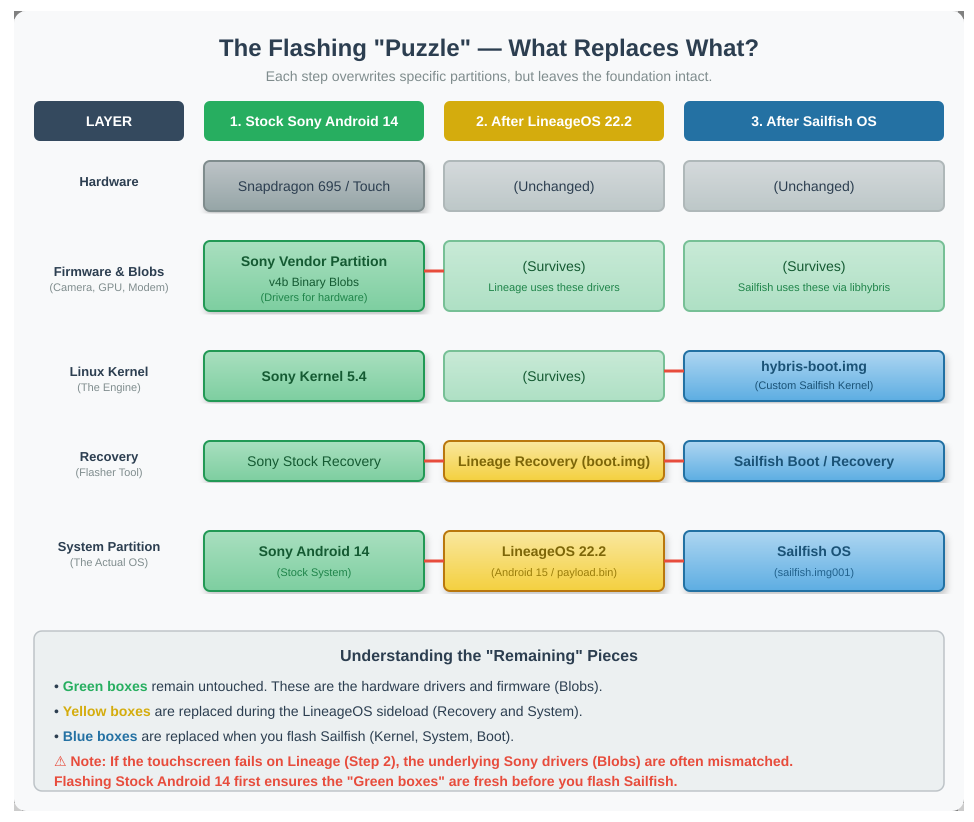

# Sailfish OS on Sony Xperia 10 V (Zambezi)

> **Note:** This repository is a community-driven knowledge base and debugging log. It was generated by **DeepSeek (AI Assistant)** based on live debugging sessions with a Sony Xperia 10 V (XQ-DC54) and is intended to help others attempting the same port.

## 📱 About the Project

This project documents the process of installing the **Sailfish OS community port** on the Sony Xperia 10 V (codename **Zambezi**, model **XQ-DC54 / PDX-235**). 

The Xperia 10 V is an interesting target because it uses the **Qualcomm Snapdragon 695** (SoC `holi`), a chip shared by many other popular phones. While the Sailfish port exists, it is still in an experimental state, and the boot process can be fragile.

The goal of this repository is to:
1. Document the exact flashing steps (Stock Android 14 → LineageOS 22.2 → Sailfish OS).
2. Provide hardware diagnostics (dmesg logs, HAL listings) from the working LineageOS base.
3. Track the known issues (boot hangs, camera crashes, battery reporting) and potential fixes.

## 🧩 The Flashing "Puzzle"

The process of getting Sailfish OS onto this device involves multiple layers. Each flash overwrites specific partitions while leaving the foundation intact.

  

*If the image above does not render in your Markdown viewer, you can view the raw SVG file directly in this repository.*

## 🧱 The Stack

The Sailfish OS community port for this device is built on top of:
- **Sony AOSP 14** (reference base for the device configuration, firmware `68.1.A.2.270`)
- **LineageOS 22.2** (Android 15 base used for the flashing process)
- **Sony v4b Blobs** (Proprietary binaries for the Snapdragon 695)
- **Sailfish OS 5.1** (The final OS)

## 📚 Documentation

- **[INSTALLING.md](INSTALLING.md)** — The step-by-step flashing guide (based on the developer's instructions).
- **[TROUBLESHOOTING.md](TROUBLESHOOTING.md)** — Debugging the "Sony Logo" hang, capturing kernel logs, and analyzing hardware states.
- **[gather_info.py](gather_info.py)** — A diagnostic script to collect HALs, input devices, and kernel logs from a working LineageOS install. **Includes a `--scrub` flag to redact MAC/IP addresses before publishing.**

## ⚠️ Current Status & Known Issues

The port is **not yet a daily driver**. Based on our testing:

- **Boot Hang**: The device can hang indefinitely at the Sony logo during the `hybris-boot` handoff. This appears to be a kernel/userspace issue rather than a hardware fault.
- **Touchscreen**: Works perfectly in LineageOS (proving the hardware is fine), but the Sailfish compositor may fail to initialize the display.
- **Camera**: The main camera is likely to crash-loop. The `v4b` Sony binaries are required, but the camera HAL still has missing dependencies (`libofflinelog.so`, etc.).
- **Battery**: The battery indicator may fluctuate or fail to update. This is a known issue with the `smblib` charger driver on this platform.
- **Fastboot**: Sony's bootloader blocks `fastboot boot` (booting an image from RAM). You must flash the `hybris-boot.img` to the `boot_a` slot, and Sony's fastboot implementation is sensitive to newer versions of the `fastboot` tool.

## 🛠️ Hardware Diagnostics

We captured extensive logs from the **working LineageOS 22.2** system to serve as a baseline. This data includes:

- **HAL Libraries**: The `vendor/lib64/hw/` directory, including `gralloc.default.so`, `hwcomposer`, and `vulkan.adreno.so`.
- **Kernel Modules**: The loaded `focaltech_fts` (touchscreen), `aw882xx_dlkm` (audio), and `camera` modules.
- **Input Devices**: Confirmation that the FocalTech touchscreen (`fts_ts`) and Egis fingerprint sensor are detected correctly.

This baseline is useful for comparing against the Sailfish kernel logs to spot missing drivers.

## 🔗 Credits & References

- **LineageOS**: For providing a stable Android base and the flashing instructions.
- **Sony**: For the AOSP device configurations and proprietary binaries.
- **The Sailfish OS Community**: For the `droid-hal` and `hybris-boot` tooling.
- **sharks-dev**: For the Zambezi Sailfish OS port.

## 🤝 Contributing

If you have successfully booted Sailfish OS on this device, or if you have patched the kernel to fix the boot hang, please open an issue or submit a pull request. The goal is to move this port from "experimental" to "daily driver".

Remind you, this is for the most Deepseeks work with my commands... and i'm learning the Deepseek is not always correct... so after a lot of flashing i'm not sure the Sony v4b Blobs are actually installed..

*Last updated: October 2026.*
